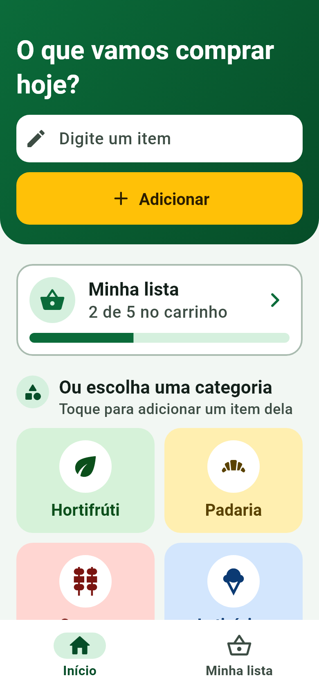
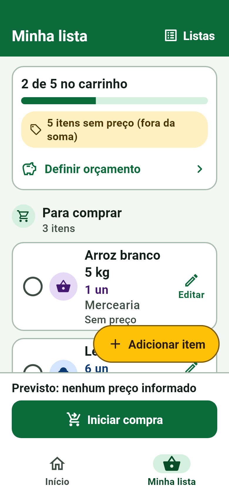
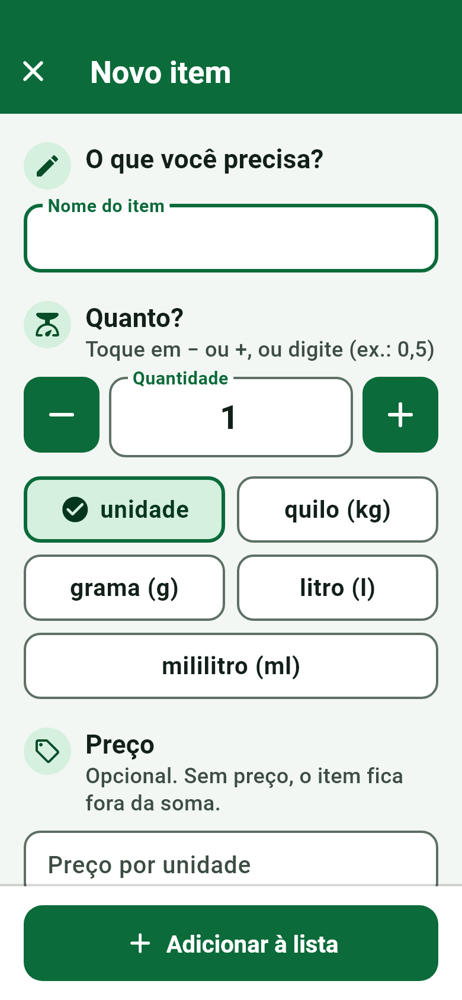
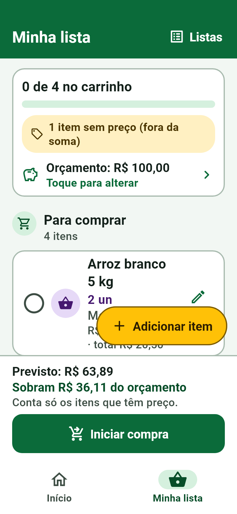
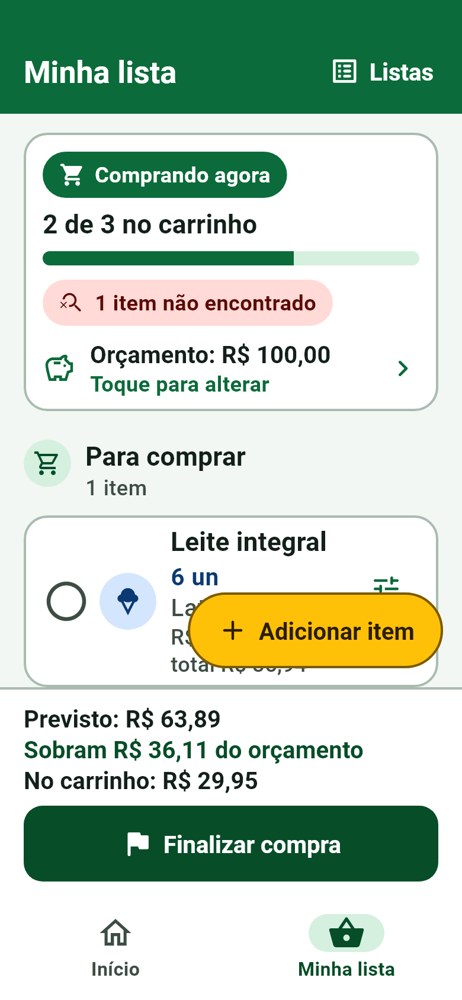
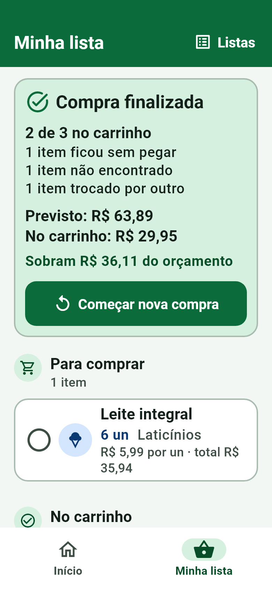

<p align="center">
  
</p>

<h3 align="center">Sua lista de compras inteligente — simples de usar, feita para funcionar sem internet.</h3>

<p align="center">
  
  
  
  
</p>

O **anotAI Lista** é um aplicativo Android/iOS (Flutter) para montar listas de compras, acompanhar o quanto elas vão custar e conduzir a ida ao mercado. Tudo fica guardado **no próprio aparelho**: não pede cadastro, não pede localização, não pede câmera e não precisa de internet.

Este repositório é o recorte "só a lista" de um projeto maior. Aqui está o app completo de listas e valores — nada além disso.

## Capturas de tela

<p align="center">
  
  
  
  
</p>
<p align="center">
  
  
  
</p>

> As capturas são geradas pelo próprio projeto (`test/screenshots_test.dart`), com dados fictícios.

## Funcionalidades

**Montar a lista**
- Adicionar rápido pelo Início: digitou, tocou em *Adicionar*, 1 unidade na lista.
- Formulário completo: nome, quantidade (botões **−/+** com passo conforme a unidade, ou digitando, ex.: `0,5`), unidade (`un`, `kg`, `g`, `l`, `ml`), preço e categoria.
- Oito categorias iniciais (Hortifrúti, Padaria, Carnes, Laticínios, Mercearia, Bebidas, Limpeza, Higiene), cada uma com cor e ícone próprios.
- Várias listas: criar, trocar, renomear e excluir (com confirmação).
- Remover um item sempre oferece **Desfazer**.

**Valores**
- Preço **previsto** por item e total do item calculado na hora (`quantidade × preço`).
- Total previsto da lista com **cobertura explícita**: itens sem preço ficam fora da soma e a tela diz quantos são — nunca aparece um "total" enganoso.
- **Orçamento** opcional: mostra quanto sobra ou quanto estourou.
- Histórico de preços de cada item guardado localmente (só cresce, nunca é sobrescrito).

**Modo compra**
- *Iniciar compra* troca a lista para o modo mercado. Tocar no cartão coloca o item **no carrinho**.
- Em *Opções* de cada item: **Peguei**, **Troquei por outro** (com o nome do substituto), **Não encontrei** ou **Ainda não peguei**, e o **preço encontrado** no mercado — separado do previsto, que não é alterado.
- A lista se divide em *Para comprar*, *No carrinho* e *Não encontrados*, com barra de progresso.
- *Finalizar compra* mostra o resumo (previsto × no carrinho × orçamento); itens pendentes nunca são apagados. *Começar nova compra* reaproveita a lista.

**Acessibilidade e robustez**
- Texto grande, alvos de toque de pelo menos 56 dp, ícone sempre acompanhado de palavra, cores de alto contraste.
- Testado com fonte a 200% em tela pequena (320×568), sem estouro de layout.
- Estados de carregamento, vazio e erro tratados (inclusive falha ao abrir o banco, com "Tentar de novo").
- Tudo em português do Brasil.

## Regras de dinheiro

Dinheiro é sensível a erros de arredondamento, então o app segue regras estritas (veja `lib/core/money.dart` e `lib/features/lists/domain/list_totals.dart`):

- **Nunca `double`.** Preços e quantidades usam `Decimal` e são gravados como texto decimal exato no SQLite.
- Subtotal de cada linha = `quantidade × preço unitário`, arredondado para 2 casas (metade para cima); o total é a soma das linhas.
- **Preço ausente é `null`**, nunca zero. Zero e valores negativos são recusados. Exemplo: arroz `2 × 10,25` + um item sem preço mostra **R$ 20,50** e "1 item sem preço (fora da soma)".
- Entrada numérica só com **vírgula** (`1,5`); ponto é recusado para não confundir milhar com decimal.
- "No carrinho" **não significa pago**, e o preço encontrado nunca altera o previsto.

## Arquitetura

```
lib/
├── main.dart · app.dart            # ProviderScope, rotas (go_router) e tela de abertura
├── core/
│   ├── database/                   # Drift (SQLite): tabelas e banco
│   ├── theme/                      # tokens de design, tema e estilo das categorias
│   ├── widgets/                    # componentes reutilizáveis (IconLabel, ChoiceGrid, ...)
│   ├── money.dart · format.dart    # regras de dinheiro e formatação pt-BR
│   └── providers.dart              # providers Riverpod (banco, repositório, streams)
└── features/
    ├── home/                       # tela Início
    ├── lists/
    │   ├── data/                   # ShoppingListRepository (única porta para o banco)
    │   ├── domain/                 # totais e orçamento (puro Dart, sem banco)
    │   └── presentation/           # Minha lista, formulário, resultado do item, listas
    └── splash/                     # tela de carregamento
```

- **Estado:** Riverpod 3. Os dados chegam por `StreamProvider` sobre consultas reativas do Drift, então a interface se atualiza sozinha quando o banco muda.
- **Persistência:** Drift/SQLite local, com chaves estrangeiras ativas e `CHECK` no banco para quantidade e preço. O schema está versionado em `drift_schemas/` para futuras migrações incrementais verificadas por teste.
- **Camadas:** widgets não têm SQL; o repositório valida (nome, quantidade, unidade, preço) e lança `ValidationException`; os cálculos de totais são funções puras testáveis sem banco nem Flutter.
- **Sem rede:** o manifesto de release não declara permissão de internet, localização nem câmera (só os manifestos de debug/profile pedem internet, para o hot reload do Flutter).

## Como executar

Requisitos: [Flutter](https://docs.flutter.dev/get-started/install) 3.47.9 (veja `.flutter-version`) e, para Android, o Android SDK com um aparelho ou emulador.

```bash
flutter pub get
flutter run                  # no aparelho/emulador conectado
flutter build apk --release  # gera build/app/outputs/flutter-apk/app-release.apk
```

> O build de release usa a chave de **debug** (`android/app/build.gradle.kts`) só para facilitar testes. Antes de publicar em loja, configure sua própria assinatura.

## Qualidade

```bash
dart format --output=none --set-exit-if-changed lib test
flutter analyze
flutter test
```

A suíte tem mais de 80 testes: regras de dinheiro e totais, repositório (validações, snapshots de preço, persistência entre aberturas do app), schema do banco e fluxos completos de interface em widget tests — montar lista, orçamento, modo compra, desfazer, texto a 200%, alinhamento e alvos de toque.

Para regenerar as capturas de tela do README:

```bash
SCREENSHOT_DIR=docs/screenshots flutter test test/screenshots_test.dart
```

Depois de alterar as tabelas do Drift:

```bash
dart run build_runner build --delete-conflicting-outputs
dart run drift_dev schema dump lib/core/database/app_database.dart drift_schemas/
dart run drift_dev schema generate drift_schemas/ test/generated_migrations/
```

## Stack

| Camada | Tecnologia |
| --- | --- |
| UI | Flutter (Material 3), tema próprio com tokens de design |
| Estado | `flutter_riverpod` |
| Navegação | `go_router` (abas com `StatefulShellRoute`) |
| Dados | `drift` + `drift_flutter` (SQLite) |
| Dinheiro | `decimal` |
| Testes | `flutter_test`, banco Drift em memória |

## Licença

Distribuído sob a licença [MIT](LICENSE).
